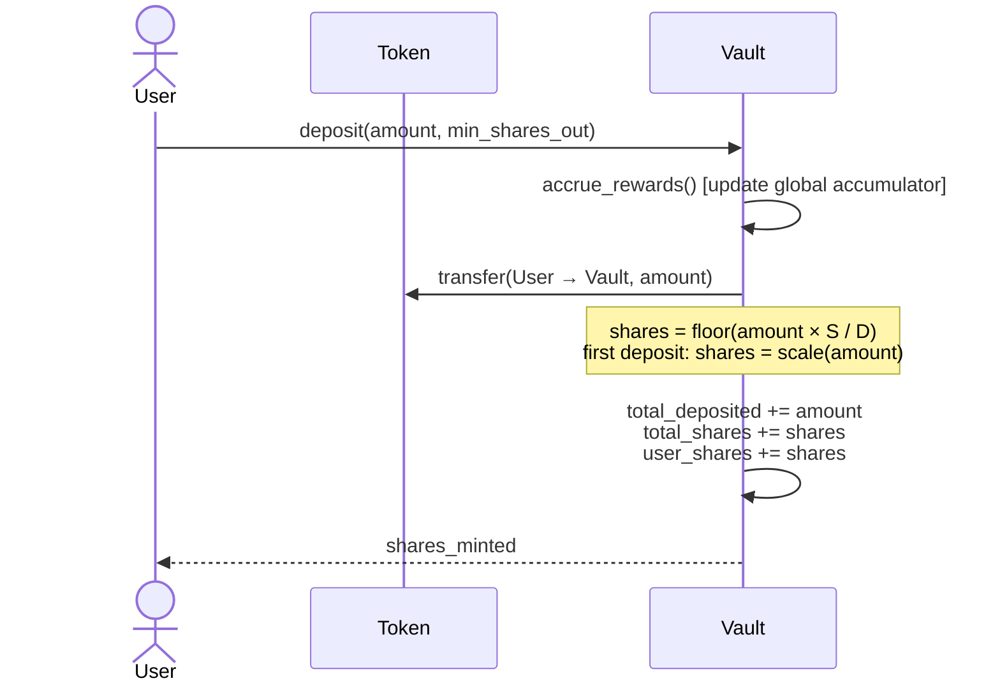
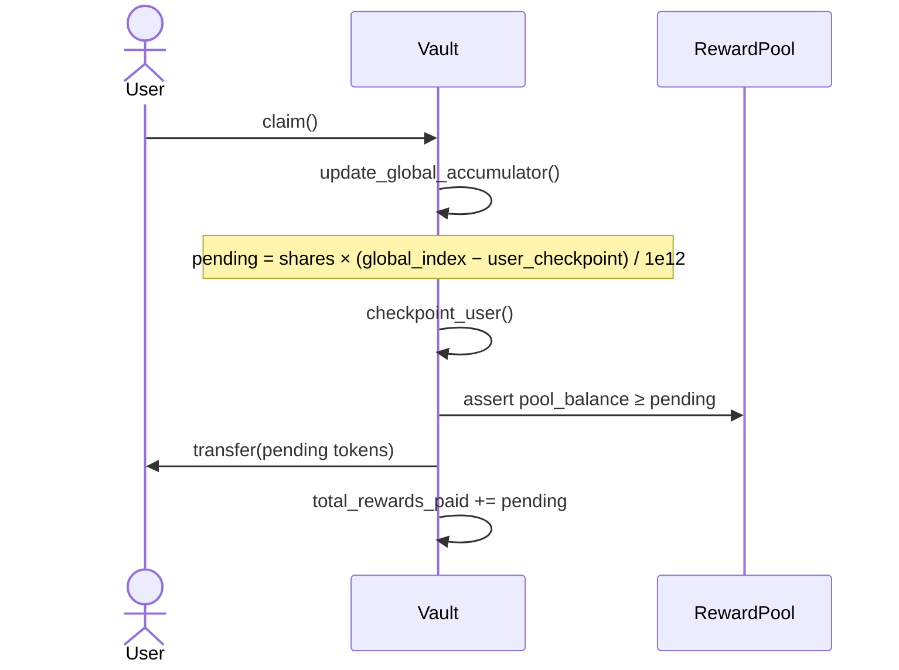
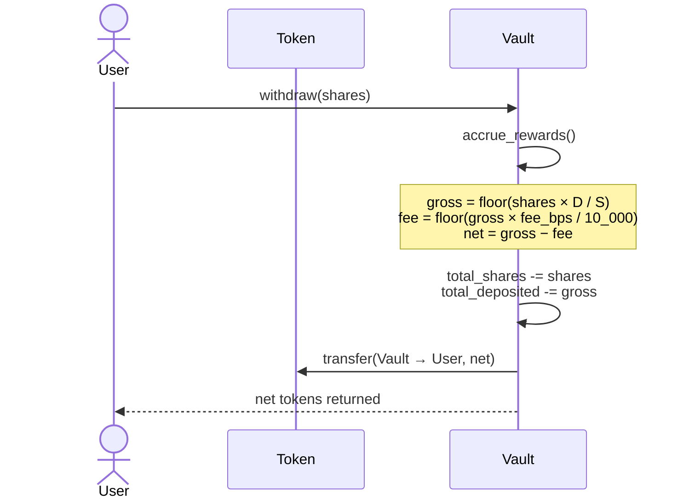

# Economics of the Stellar DeFi Vault

This document explains the vault's economic model in plain language with
worked numeric examples. Every formula here matches the implementation in
`src/balance.rs` and `src/reward_math.rs`; each worked example is cross-
referenced to an existing test so you can verify the numbers independently.

---

## 1. Share Minting

Shares are the vault's internal unit of account. They are denominated at
**7 decimal places** regardless of the underlying token's precision.

### First deposit

When the vault is empty (`total_shares = 0` or `total_deposited = 0`) the
first depositor receives shares equal to the token amount scaled to 7
decimal places:

```
shares_minted = amount × 10^(7 − token_decimals)   when token_decimals ≤ 7
shares_minted = amount ÷ 10^(token_decimals − 7)   when token_decimals > 7
```

**Example 1a — 7-decimal token (default)**

Alice deposits 500,000 units into an empty vault (token has 7 decimals,
so the scale factor is ×1):

| Variable          | Value      |
|-------------------|------------|
| `amount`          | 500,000    |
| `total_shares`    | 0 (before) |
| `total_deposited` | 0 (before) |
| `shares_minted`   | **500,000** |
| `total_shares`    | 500,000 (after) |
| `total_deposited` | 500,000 (after) |

Share price after first deposit: `D / S = 500,000 / 500,000 = 1.0`

Test reference: `test_first_deposit_mints_1to1_shares` in `src/test.rs`.

**Example 1b — 6-decimal token**

A 6-decimal token has 1,000,000 base units per "full" token. Alice deposits
1,000,000 base units:

```
shares_minted = 1_000_000 × 10^(7-6) = 1_000_000 × 10 = 10_000_000
```

| Variable          | Value      |
|-------------------|------------|
| `amount`          | 1,000,000  |
| `token_decimals`  | 6          |
| `shares_minted`   | **10,000,000** |
| `preview_redeem(10_000_000)` | 1,000,000 |

Test reference: `share_price_uses_queried_non_default_token_decimals` in
`src/test_share_decimals.rs`.

### Subsequent deposits

After the first deposit the ratio is proportional to the existing pool:

```
shares_minted = floor(amount × total_shares / total_deposited)
```

**Example 1c — second depositor**

After Example 1a the vault has `S = 500,000`, `D = 500,000`. Bob deposits
200,000:

```
shares_minted = floor(200,000 × 500,000 / 500,000) = 200,000
```

Share price remains `D / S = 700,000 / 700,000 = 1.0`. No dilution.

---

## 2. Share Price Evolution

Share price is `D / S` where `D = total_deposited` and `S = total_shares`.
It starts at 1.0 and rises whenever yield is added to the pool without
minting new shares.

### How yield raises the price

```
add_yield(Δ):  D' = D + Δ,  S' = S  (unchanged)
```

Because `S` does not change, every existing share is worth more tokens.

**Example 2 — share price after yield**

Starting state: `S = 500,000`, `D = 500,000` (1:1).
Admin adds 100,000 tokens of yield:

| Step | `total_shares` | `total_deposited` | Share price |
|------|---------------|-------------------|-------------|
| Before yield | 500,000 | 500,000 | 1.000 |
| After yield  | 500,000 | 600,000 | 1.200 |

Alice holds 250,000 shares. Before yield she could redeem 250,000 tokens.
After yield:

```
preview_redeem(250,000) = floor(250,000 × 600,000 / 500,000) = 300,000
```

Her 250,000 shares are now worth **300,000 tokens** — a 20% increase.

Test reference: `test_add_yield_increases_share_price` in `src/test.rs`.

### What dilutes the price

A **deposit** at the current ratio mints proportional shares, leaving the
price unchanged. A **second deposit** of 600,000 after the yield above:

```
shares_minted = floor(600,000 × 500,000 / 600,000) = 500,000
```

New state: `S = 1,000,000`, `D = 1,200,000`.
Price = `1,200,000 / 1,000,000 = 1.200`. Price unchanged. ✓

---

## 3. Reward Accrual

The vault uses a **global reward accumulator** (per-share index) for O(1)
accrual, backed by a pure per-ledger formula in `src/reward_math.rs`.

### Formula

```
effective_rate = rate_bps × tier_mult   / 10,000
                           × campaign_mult / 10,000
                           × season_mult   / 10,000

reward = amount × effective_rate × elapsed_ledgers
         / 10,000 / STELLAR_LEDGERS_PER_YEAR
```

Where:
- `rate_bps` — annual rate in basis points (100 bps = 1% APR)
- `tier_mult`, `campaign_mult`, `season_mult` — boost multipliers in bps
  (10,000 = 1×, 15,000 = 1.5×). Default: all 10,000 (no boost).
- `STELLAR_LEDGERS_PER_YEAR = 6,307,200` (5-second ledger target)

### Example 3a — simple reward, no boost

Alice stakes **1,000,000 tokens** at ledger 0. Reward rate is **1,000 bps
(10% APR)**. All multipliers default to 10,000 (1×). She holds for half a
year (3,153,600 ledgers):

```
effective_rate = 1,000 × 10,000 / 10,000
                        × 10,000 / 10,000
                        × 10,000 / 10,000
               = 1,000 bps

reward = 1,000,000 × 1,000 × 3,153,600
         / 10,000 / 6,307,200
       = 1,000,000 × 0.10 × 0.5
       = 50,000
```

Alice claims **50,000 tokens** at half-year. ✓

### Example 3b — full lifecycle with rate change

This matches `test_integration_full_lifecycle` in `src/test_integration.rs`.

**Setup:**
- 5 users stake at ledger 0, rate = 1,000 bps (10% APR)
- `ANNUAL = 6,307,200 ledgers`
- Users 1 & 2 claim at `ANNUAL/2`; admin then changes rate to 500 bps (5%)
- All users unstake at `ANNUAL`

| User  | Stake     | Mid-claim (10% × ½yr) | Post-claim (5% × ½yr) | Total Reward |
|-------|-----------|------------------------|------------------------|--------------|
| user1 | 1,000,000 | 50,000                 | 25,000                 | **75,000**   |
| user2 | 2,000,000 | 100,000                | 50,000                 | **150,000**  |
| user3 | 3,000,000 | —                      | 150,000 (5% × 1yr)     | **150,000**  |
| user4 | 4,000,000 | —                      | 200,000                | **200,000**  |
| user5 | 5,000,000 | —                      | 250,000                | **250,000**  |
| **Total** |       |                        |                        | **825,000**  |

Users 3–5 never claimed mid-way. When they unstake at `ANNUAL` the
accumulator settles at the current rate (500 bps), so they earn 5% for
the full year — **not** 10% for the first half.

Users 1 & 2 checkpointed at `ANNUAL/2` while the rate was still 10%, so
their second half accrues at 5%:

```
user1: mid = 1,000,000 × 1,000 × (ANNUAL/2) / 10,000 / ANNUAL = 50,000
       post= 1,000,000 ×   500 × (ANNUAL/2) / 10,000 / ANNUAL = 25,000
       total = 75,000
```

Test reference: `test_integration_full_lifecycle` in
`src/test_integration.rs` (verified assertion `total_rewards_paid == 825,000`).

---

## 4. Fees

### Unstake fee

When an unstake fee (`unstake_fee_bps`) is configured, the vault retains
a fraction of the gross withdrawal amount:

```
gross = floor(shares × total_deposited / total_shares)
fee   = floor(gross × unstake_fee_bps / 10,000)
net_returned = gross − fee
```

The fee stays inside the vault: `total_deposited` decrements by `gross`
(not `net_returned`), so remaining holders receive the fee as extra
backing. This increases the share price for everyone who does not unstake.

**Example 4 — 1% unstake fee**

Vault state: `S = 1,000,000`, `D = 1,000,000`, fee = 100 bps (1%).
Bob unstakes his 200,000 shares:

```
gross = floor(200,000 × 1,000,000 / 1,000,000) = 200,000
fee   = floor(200,000 × 100 / 10,000) = 2,000
net   = 200,000 − 2,000 = 198,000
```

Bob receives **198,000 tokens**. The 2,000-token fee stays in the vault.
Remaining shares: `S = 800,000`, `D = 800,000`. Price unchanged at 1.0.

Cap: `MAX_UNSTAKE_FEE_BPS = 500` (5%).

### Deposit fee (configurable)

When `deposit_fee_bps > 0` the effective amount used to compute shares is
reduced:

```
effective_amount = amount − floor(amount × deposit_fee_bps / 10,000)
shares_minted    = floor(effective_amount × total_shares / total_deposited)
```

The fee stays in `total_deposited`, raising the share price for all
existing holders.

---

## 5. Boosts and How They Stack

Three independent boost multipliers stack multiplicatively on top of the
base reward rate:

```
effective_rate = rate_bps
  × tier_mult        / 10,000   ← time-in-vault tier (up to 5 tiers)
  × campaign_mult    / 10,000   ← admin-launched boost campaign
  × season_mult      / 10,000   ← seasonal schedule
```

All three default to 10,000 (1×). The result is annualised as described in
Section 3.

### Boost tiers

Up to 5 tiers (`MAX_BOOST_TIERS = 5`), each defined by a
`(ledger_threshold, multiplier_bps)` pair. A user's active tier is the
highest whose `ledger_threshold ≤ (current_ledger − staked_at_ledger)`.

**Example 5 — boost tiers stacked with a campaign**

- Base rate: 1,000 bps (10% APR)
- Tier 1: after 100,000 ledgers → 12,000 bps (1.2×)
- Active campaign: 11,000 bps (1.1×)
- No season multiplier (10,000)

Alice has been staked for 150,000 ledgers so she is on tier 1:

```
effective_rate = 1,000 × 12,000 / 10,000 × 11,000 / 10,000 × 10,000 / 10,000
              = 1,000 × 1.2 × 1.1
              = 1,320 bps (13.2% APR)
```

For 1,000,000 staked tokens over one full year:

```
reward = 1,000,000 × 1,320 × 6,307,200 / 10,000 / 6,307,200
       = 1,000,000 × 0.1320
       = 132,000 tokens
```

### Overflow headroom

The accumulator scales intermediate values by `ACCUMULATOR_SCALE = 1e12`.
Analysis in `src/reward_accumulator.rs` shows `>340,000×` headroom before
`i128::MAX` is reached under maximum parameters (500% APR, 10¹⁸ staked
stroops, 100-year horizon).

---

## 6. Sequence Diagrams

### Deposit



### Claim



### Withdraw



---

## 7. Constants Reference

| Constant | Value | Meaning |
|---|---|---|
| `STELLAR_LEDGERS_PER_YEAR` | 6,307,200 | Ledgers/year at 5 s each |
| `LEDGERS_PER_DAY` | 17,280 | Ledgers/day at 5 s each |
| `BOOST_BPS_BASE` | 10,000 | 1× multiplier (no boost) |
| `MAX_BOOST_TIERS` | 5 | Maximum boost tier entries |
| `MAX_UNSTAKE_FEE_BPS` | 500 | 5% fee cap |
| `DEFAULT_TOKEN_DECIMALS` | 7 | Internal share precision |
| `ACCUMULATOR_SCALE` | 1,000,000,000,000 | 1e12 accumulator precision |
